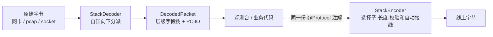
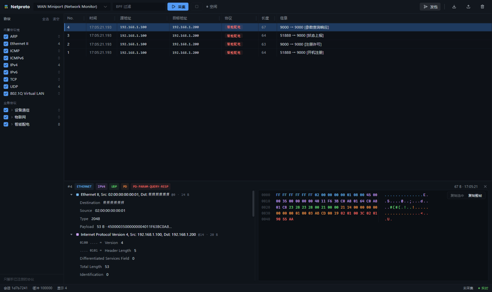
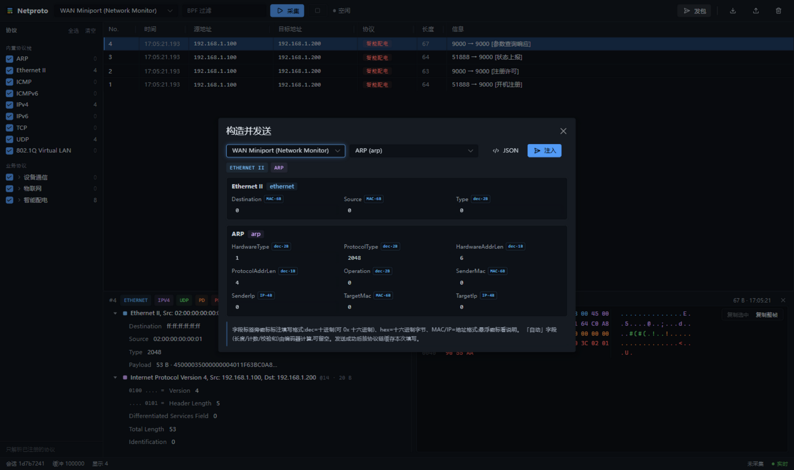

<div align="center">

# NetProto

**注解驱动的自顶向下二进制协议引擎**

一个 POJO + 注解,声明任意二进制协议 —— 条件字段、变长、位级、四种循环、异质 TLV、
校验和、帧尾 CRC,全部声明式;`Ethernet → IPv4 → UDP → 你的业务协议`
整条栈用同一套机制自顶向下分派。

**只解析被 `@Protocol` 标记的协议,其余流量保持原始字节。**


</div>

---

## 为什么是自顶向下

传统解析器靠手写 `if (type == X) parseX()` 串联,协议一多就不可维护;
pcap4j 这类库把协议写死在类型体系里,新协议只能 fork。
NetProto 把「下一层是谁」也变成声明(`@BindOn(parent, when)`):
解析一层 → 求值子绑定 → 命中则继续下降,没有命中就停在当前层,
剩余字节原样保留 —— **未注册的流量不猜、不丢、不解析**。
组装方向对称:`StackEncoder` 自内向外包装,选择子(EtherType / 端口 / 你的类型字段)、
长度、校验和全部自动接线。

```java
@Protocol(id = "udp")
@BindOn(parent = "ipv4", when = "protocol == 17")
@BindOn(parent = "ipv6", when = "nextHeader == 17")
class UdpSegment { /* 字段 */ }

@Protocol(id = "my-app")
@BindOn(parent = "udp", when = "dstPort == 9999 || srcPort == 9999")
class MyProtocol { /* 字段 */ }
```



## 特性一览

- **声明式协议定义** —— 字段顺序、位宽、端序、变长、条件、循环、TLV 分派,零手写序列化代码
- **自顶向下分派** —— `@BindOn` 声明父层条件,协议栈即分派树;内置栈与业务协议同一套机制
- **只解析被标注的协议** —— 机制保证,不是约定
- **编解码对称** —— round-trip 是验收标准;同一份注解同时驱动解析与组装
- **帧尾字段** —— 长度驱动 `@Payload` + 尾随字段,专治「公共头 + 类型分派 + 帧尾 CRC」形态
- **三级逃生舱** —— L1 声明式动态、L2 字段级 `FieldCodec`、L3 报文级 `PacketCodec`,长尾格式不用改引擎
- **Spring Boot 自动装配** —— 扫描 `@Protocol` 即注册,配置错误启动即 fail-fast
- **内置观测台** —— 实时帧表格(10 万行虚拟滚动)、层级字段树、hex/ASCII 选区、分层发包、pcap 导入导出
- **core 零第三方依赖** —— 仅 `slf4j-api`,不依赖 Spring / pcap4j / Jackson

## 快速开始

**要求**:JDK 25、Maven 3.9+;Windows 上采集/发包需安装 [Npcap](https://npcap.com/) 并以管理员身份运行。

```bash
# 构建本分支两个库模块(含测试)
mvn install
```

想直接看运行效果,切到演示分支:`git switch redesign/protocol-stack`,
再 `mvn -pl netproto-demo spring-boot:run`,打开 http://localhost:8848。

前端源码开发(热更新,`/api` 代理到 8848):

```bash
cd netproto-web/ui
npm install
npm run dev          # http://localhost:5173
npm run build        # 产物直接落进 netproto-web/src/main/resources/static,打 jar 即带页面
```

在自己的 Spring Boot 工程里引入 starter:

```xml
<dependency>
    <groupId>com.netproto</groupId>
    <artifactId>netproto-web</artifactId>
    <version>0.1.0-SNAPSHOT</version>
</dependency>
```

加上依赖、写好 `@Protocol` 类,启动即完成注册与装配。

### 三分钟接入

```java
@Protocol(id = "my-app", name = "My App Protocol")
@BindOn(parent = "udp", when = "dstPort == 9999 || srcPort == 9999")
@Data
public class MyProtocol {

    @ProtocolField(order = 1, size = 8)  private byte version = 1;
    @ProtocolField(order = 2, size = 8)  private byte type;
    @ProtocolField(order = 3, size = 16) private short reserved;
    @ProtocolField(order = 4, size = 32) private int sequenceId;

    @Payload                              private byte[] payloadData;
}
```

线上出现 UDP 9999 的流量时,自动走完 `ethernet▸ipv4▸udp▸my-app` 四层解析。
已有 pcap 想验证?观测台直接导入;测试里两行完成编解码:

```java
// 编码:POJO 列表(外层 → 内层)
byte[] frame = encoder.encode(List.of(ethernet, ipv4, udp, myProtocol));

// 解码:字节从根协议自顶向下分派
DecodedPacket p = decoder.decode(frame, "udp", 0, 1);
MyProtocol msg = (MyProtocol) p.layers().get(3).packet();
```


## 文档

| 文档 | 内容 |
|---|---|
| [注解语言参考](docs/annotation-reference.md) | 全注解属性、四种循环驱动、表达式语法、注册期校验规则 |
| [协议栈:分派与组装](docs/protocol-stack.md) | 分派树、自动接线、注册表与 Spring 装配、模块布局 |
| [逃生舱 L1/L2/L3](docs/escape-hatch.md) | 选型决策树、`FieldCodec` / `PacketCodec` 契约与真实用例 |
| [如何测试你的协议](docs/testing-your-protocol.md) | 权威向量法、校验和自证、边界清单、常见坑 |
| [能力边界报告](docs/format-boundary-report.md) | 59 协议调研 × 机制矩阵 × 18 真实协议实测 |

## 架构与模块

```
netproto-core   注解 · 反射引擎 · 分派树 · 内置栈(零框架依赖)
netproto-web    Spring Boot starter:自动装配 · 观测台 · REST/SSE · 采集/发包
```

core 不依赖 Spring —— 不用观测台也可以把它当纯编解码库嵌进任意工程(见「把引擎用在后端」)。
完整演示应用(三套业务协议)在 `redesign/protocol-stack` 分支的 `netproto-demo` 模块。

## 内置协议栈

`com.netproto.protocols.builtin`,与业务协议同一套机制,可整体替换:

| 协议 | 挂载条件 | 协议 | 挂载条件 |
|---|---|---|---|
| `ethernet` | 根协议(可配 `root-protocol`) | `ipv6` | `etherType == 0x86DD` |
| `vlan` | `etherType == 0x8100` | `icmp` | `protocol == 1` |
| `arp` | `etherType == 0x0806` | `icmpv6` | `nextHeader == 58` |
| `ipv4` | `etherType == 0x0800` | `tcp` | `protocol` / `nextHeader == 6` |
| | | `udp` | `protocol` / `nextHeader == 17` |

不想用内置栈:`netproto.builtin-packages: []`,并提供自己的根协议。

## Spring Boot 配置

```yaml
netproto:
  enabled: true              # 总开关
  base-packages: []          # 用户协议扫描包;留空 = 自动探测 @SpringBootApplication 所在包
  builtin-packages:          # 内置栈扫描包(设 [] 可禁用)
    - com.netproto.protocols.builtin
  root-protocol: ethernet    # 分派树根
  ring-size: 100000          # 环形缓冲帧数上限
  ring-bytes: 16MB           # 内存预算(与帧数上限取先到者)
  snaplen: 65536             # 采集截断长度
```

## 观测台与 REST / SSE API

观测台(`http://localhost:8848`):实时帧表格、点击帧看层级字段树 + hex/ASCII 选区联动、
按协议/多级分组过滤、分层发包面板(字段表单,长度/校验和/选择子自动)、pcap 导入导出。
前端源码在 `netproto-web/ui`(Vite,`npm run dev` 热更新)。

**帧详情** —— 左侧协议分组过滤,中部实时帧表格,选中帧展示层级字段树与 hex/ASCII
双视图,点树节点字节选区联动高亮:



**分层发包** —— 选目标协议自动推导整条协议链,分层表单带格式徽标(`MAC·6B` / `IP·4B` /
`dec·2B`),长度/校验和/选择子自动,可切 JSON 高级模式:



```
GET  /api/netproto/config             # 运行配置只读视图
GET  /api/netproto/protocols          # 注册协议 + 字段元数据(id/name/groupPath/category/fields)
GET  /api/netproto/template?path=     # 按分派树推导协议链,生成发包模板
GET  /api/netproto/interfaces         # 网卡列表
POST /api/netproto/capture/start      # {iface, bpf?}
POST /api/netproto/capture/stop
GET  /api/netproto/capture/status
GET  /api/netproto/packets?limit=     # 最近帧摘要(结构化)
GET  /api/netproto/packet/{seq}       # 单帧完整详情(按需重解码)
GET  /api/netproto/stream             # SSE 实时推送(事件 packet / ping)
POST /api/netproto/inject             # {hex} 注入原始帧,走完整解析管线(不经过网卡)
POST /api/netproto/send               # {iface, layers:[{protocol, fields}]} 原始以太网注入
GET  /api/netproto/export             # 环形缓冲导出 .pcap
POST /api/netproto/import             # 导入 .pcap(multipart,仅以太网链路)
```

发包 JSON 便捷格式:`byte[]` 字段给 hex 字符串;`*Mac` 给 `"aa:bb:cc:dd:ee:ff"`;
`*Ip` 给点分十进制;选择子与长度字段自动填写,显式值优先。

## 把引擎用在后端(而非抓包)

core 的编解码入口只认字节数组,数据来自网卡、socket 还是文件与它无关:

```java
// 收到一批字节 → POJO
PdFrame msg = (PdFrame) registry.get("pd").codec().decode(buf, 0, buf.length);

// 回包:POJO → 字节
byte[] out = encoder.encode(List.of(responseHeader, responsePdu));
```

需要清楚的边界:

- **一个数据报 / 一条完整消息的字节**才归它管。TCP 粘包/拆包必须在前面做组帧
  (长度字段、定界符或 Netty 的 `LengthBasedFrameDecoder`),切出完整报文再喂给 codec;
  UDP 天然定界,可直接解。
- **协议无状态**:会话序号校验、握手状态机、重传逻辑属于业务层。
- 反射式编解码适合业务协议量级(每秒数千~数万条),不适合做百万 PPS 的转发面。
- 解码失败会优雅停止(异常被捕获、停在当前层),但面向公网端口前请自行补齐输入上限与越界防护。

## 已验证的真实协议

18 个协议族 / 46 个字节级用例(权威向量 + round-trip),见
`netproto-core/src/test/java/com/netproto/protocols/real/`:

- **电力/工控**:Modbus RTU(CRC-16 标准向量)、Modbus TCP、DL/T 645(+0x33 混淆)、IEC 60870-5-101/104、HART
- **车载**:SOME/IP、ISO-TP(nibble 12bit 长度)
- **网络/IoT**:ARP、ICMP、DNS(含 Ethernet▸IPv4▸UDP▸DNS 全栈)、MQTT 3.1.1、MQTT-SN、CoAP、WebSocket、QUIC varint、BSON

实测:72% 纯声明式,28% 用 L2 逃生舱(变长整数/转义/混淆/掩码类),无一处被引擎卡住。

## 测试

```bash
mvn test        # 232 个测试(core 216 / web 16)
```

测试方法论(权威向量、校验和三方自证、畸形输入兜底)见
[testing-your-protocol.md](docs/testing-your-protocol.md)。

## 诚实边界

- Windows 采集/发包需要 **Npcap + 管理员权限**;Wi-Fi 网卡通常拒绝原始帧注入,建议有线网卡。
- 原始帧注入无内核栈握手;UDP 校验和发 0(IPv4 下合法),TCP 校验和不含伪首部(演示边界)。
- 发送帧不含 FCS(通常由驱动负责);本机采集通常看不到自己注入的帧(取决于驱动/平台)。
- **IP 分片重组、TCP 流重组未实现** —— 属帧后处理器职责,`DecodedPacket` 消费接口已预留。
- IPv6 只实现固定基本头(扩展头链不在分派树内,解析停在 ipv6 层);IPv4 未建模 options(IHL=5)。
- 位填充/字节转义(HDLC/PPP/DNP3 类)与加密交叠格式不在声明式范围 —— 由 L3 逃生舱或上层承担,论证见能力边界报告。
