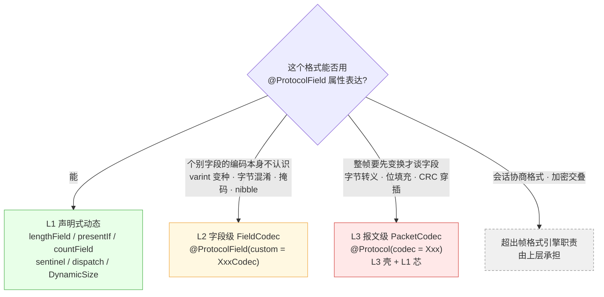

# 逃生舱(L1 / L2 / L3)

**设计原则:能用注解声明的绝不写代码;声明不了的,把「怪」隔离在最小的代码单元里,其余字段/协议仍是纯声明式。**

## 选型决策



实测比例(18 个真实协议):**72% 纯 L1,28% 用 L2,0% 需要 L3** —— 详见
[format-boundary-report.md](format-boundary-report.md) 第七节。

---

## L1:声明式动态(不是逃生舱,是基本功)

长度族(`lengthField + lengthUnit + lengthAdjust + lengthAscii`)、条件(`presentIf`)、
四种循环驱动、TLV `dispatch`、`sentinel*` 全部见
[annotation-reference.md](annotation-reference.md)。L1 里唯一要写代码的是两个钩子接口:

```java
// ① 长度算法复杂/多字段联动:算术长度(如字单位 ×32、长度逃逸三态)
public class WordUnitFrame implements DynamicSize {
    @Override
    public long computeSize(String fieldName, FieldContext ctx) {
        if (!"data".equals(fieldName)) return -1;      // -1 = 交还声明式
        return ctx.getInt("wordCount") * 32L;          // IPv4 IHL 式
    }
}

// ② 组装期长度回填(挂进分派树时由 StackEncoder 调用)
public class PdFrame implements PayloadAware {
    @Override public void onPayload(byte[] inner) { this.frameLength = 16 + inner.length; }
}
```

**零逃生舱的经典案例** —— WebSocket 三档长度逃逸(直存 → 126 转 16bit → 127 转 64bit)
只需 `presentIf` 三态 + `DynamicSize`:

```java
@ProtocolField(order = 2, size = 7)                              private int len7;
@ProtocolField(order = 3, size = 16, presentIf = "len7==126")    private int len16;
@ProtocolField(order = 4, size = 64, presentIf = "len7==127")    private long len64;
// payload 长度 = computeSize 里按 len7 三态取值
```

## L2:字段级 FieldCodec

### 契约(三个方法,缺一不可)

```java
public class XxxCodec implements FieldCodec<byte[]> {
    // 读:从游标当前位置读出值(自行推进);ctx 能读"更早的字段"
    public byte[] read(BitCursor cursor, FieldContext ctx, int remainingBytes) { ... }
    // 写:与 read 严格互逆
    public void write(BitCursor cursor, FieldContext ctx, byte[] value) { ... }
    // 序列化位宽(两遍式序列化第一遍算总长用,必须与 write 写出的一致)
    public long sizeOf(byte[] value) { ... }
}
```

```java
@ProtocolField(order = 5, type = FieldType.BYTES, custom = XxxCodec.class)
private byte[] data;
```

### 四条规则

| 规则 | 说明 |
|---|---|
| 无参构造 + 无状态 | codec 注册期创建一次,所有解码线程共享;状态放 `ctx` |
| `custom` 与尺寸声明互斥 | 不许与 `size/lengthField/countField/sentinel` 并存;需要的长度信息从 `ctx` 拿 |
| read/write/sizeOf 一致 | round-trip 是验收标准:解码值再编码必须字节相同 |
| 只旁路这一个字段 | 协议仍在分派树、观测台、组装面板正常工作 |

`ctx`(前序字段视图)是 L2 与声明式的连接点 —— 下面每个真实用例都靠它拿前序字段:

### 六个真实用例(`netproto-core/src/test/.../protocols/real/`)

| codec | 协议 | 接管什么 | 从 ctx 拿什么 |
|---|---|---|---|
| `QuicVarintCodec` | QUIC | 首 2bit 决定 1/2/4/8 字节宽的前缀定长 varint(RFC 9000 §16 四向量验证) | — |
| `VarintCodec`(内置) | MQTT / Protobuf | LEB128 变长整数 | — |
| `Plus33DataCodec` | DL/T 645 | 数据域逐字节 +0x33/-0x33 传输混淆 | `len` |
| `MaskedPayloadCodec` | WebSocket | payload 与 maskKey mod-4 循环 XOR(RFC 6455 §5.7 向量验证) | `mask`、`maskKey`、三档长度 |
| `BerLengthCodec` | BER/DER | 长形式长度(0x81/0x82 前缀),拒绝不定长 0x80 | — |
| nibble codec | CoAP | option 的半字节 delta/length + 13/14 两级逃逸(值 +13/+269) | — |
| `MqttSnLengthCodec` | MQTT-SN | Length 字节 = 0x01 时转义为 3 字节总长 | — |

### 完整示例:DL/T 645 的 +0x33 混淆

```java
public class Plus33DataCodec implements FieldCodec<byte[]> {
    @Override
    public byte[] read(BitCursor cursor, FieldContext ctx, int remainingBytes) {
        byte[] raw = cursor.readBytes(ctx.getInt("len") * 8);   // 长度来自前面的 len 字段
        for (int i = 0; i < raw.length; i++) raw[i] = (byte) (raw[i] - 0x33);
        return raw;                                             // 实体侧是明文
    }
    @Override
    public void write(BitCursor cursor, FieldContext ctx, byte[] value) {
        byte[] obf = new byte[value.length];
        for (int i = 0; i < obf.length; i++) obf[i] = (byte) (value[i] + 0x33);
        cursor.writeBytes(obf);
    }
    @Override
    public long sizeOf(byte[] value) { return value.length * 8L; }
}
```

挂上之后,实体里的 `data` 永远是明文,线上永远是混淆后的字节 —— 变换被完全隔离在这 15 行里。

## L3:报文级 PacketCodec

**整个协议**的编解码交给手写实现,反射式引擎完全旁路;但通过 `@BindOn` 照常挂回分派树:

```java
@Protocol(id = "ppp-async", codec = StuffedFrameCodec.class)
@BindOn(parent = "serial", when = "framing == 1")
class PppAsyncFrame { }
```

```java
public class StuffedFrameCodec implements PacketCodec<PppAsyncFrame> {
    private final ProtocolCodec<PppAsyncFrame> inner = new ProtocolCodec<>(PppAsyncFrame.class);

    @Override public PppAsyncFrame decode(byte[] data, int offset, int length) {
        byte[] unescaped = unescape(data, offset, length);        // 0x7D XOR 0x20 还原帧界
        return inner.decode(unescaped, 0, unescaped.length);      // 变换后走声明式内芯
    }
    @Override public byte[] encode(PppAsyncFrame p) { /* 编码 + 转义 */ }
    @Override public int headerBytes() { return -1; }   // 叶子协议;-1 之外 = 子层起始偏移
}
```

适用画像:**帧界/偏移在变换前不成立** —— PPP/SLIP 字节转义、HDLC 位填充、DNP3 的每 16 字节穿插 CRC。
典型结构是「**L3 壳 + L1 芯**」:变换用 20 行手写,内部结构仍然声明式。
参考实现:`netproto-core/src/test/.../core/BoundaryEscapeHatchTest.java` 的 `StuffedFrameCodec`。

## 明确不做(以及为什么)

| 家族 | 例子 | 为什么不进 DSL |
|---|---|---|
| 位填充/字节转义 | HDLC、PPP、SLIP、DNP3 | 整帧变换,属于 L3;注解化复杂度爆炸 |
| 值域类型族 | Protobuf wire、MessagePack | 那是序列化库的领域,不是协议帧引擎 |
| 会话协商格式 | Kermit(CHKT/转义集全协商)、XModem('C' 选 CRC) | 帧 schema 依赖链路状态,DSL 是静态的 |
| 加密交叠 | LoRaWAN/BLE/802.15.4 的 AEAD/CMAC、QUIC header protection | 解密前字段不可见,安全栈独立关注点 |
| 绝对偏移寻址 | 固定位置字段(罕见) | 与「顺序字段 + 前向依赖」模型冲突,真实需求未见 |

论证与协议级证据见 [format-boundary-report.md](format-boundary-report.md)。
