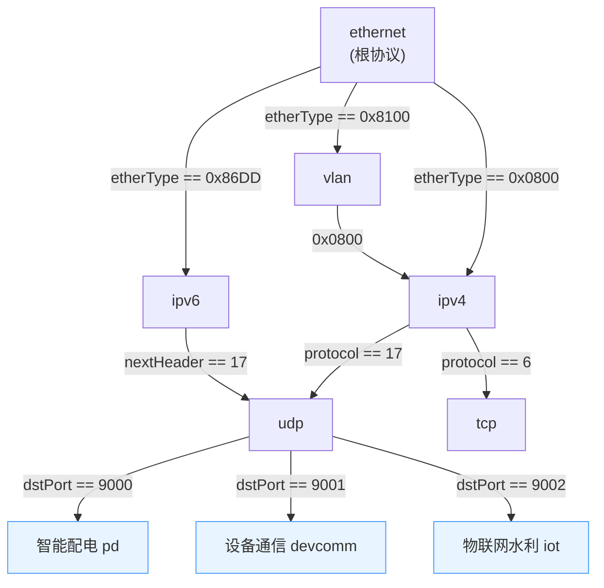
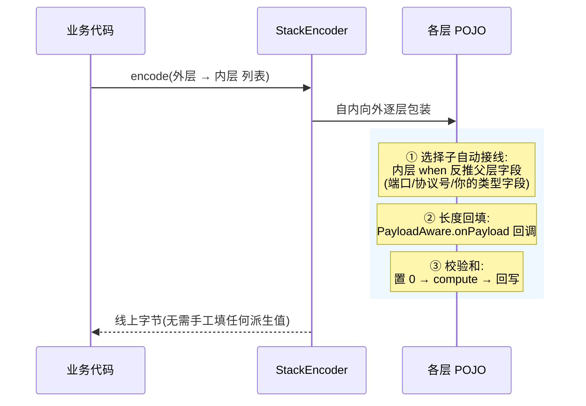

# 协议栈:自顶向下分派与自动组装

> 阅读路线:先看[注解语言参考](annotation-reference.md)了解字段级声明,本文讲**协议之间**如何组织成栈、解码与组装的双向机制。

## 1. 分派树:一条 `@BindOn` 一个父子关系

协议之间的层级关系全部由 `@BindOn` 声明,启动时构建成一棵树。以演示应用为例:



规则要点:

- **可重复挂载** —— 同一协议可挂多个父(UDP 同时挂 ipv4/ipv6);
- **多绑定优先级** —— 同父多条命中时 `priority` 高者胜,平级取注册顺序(启动告警);
- **孤岛协议** —— 不带 `@BindOn` 的协议不参与分派(串口/裸流),但可作 LIST/NESTED 元素或直接编码;
- **中间产物** —— 公共头/纯结构层标 `@Protocol(internal = true)`,不进侧栏过滤与发包目标,解码树照常展示。

## 2. 解码:StackDecoder(自顶向下)

从根协议开始:**解析一层 → 对已解析字段求值子绑定 → 命中则从头部之后继续下降;没有命中就停在当前层,剩余字节原样保留**。

```mermaid
sequenceDiagram
    participant C as 采集/pcap/业务字节
    participant D as StackDecoder
    C->>D: 原始帧(ethernet 起)
    D->>D: 解析 ethernet,求值子绑定
    Note over D: etherType == 0x0800 命中 → 下降
    D->>D: 解析 ipv4(跳过 14B 头)
    Note over D: protocol == 17 → udp;dstPort == 9000 → pd
    D->>D: 解析 pd 公共头 + 信令体(signalType 分派)
    D-->>C: DecodedPacket:层级树 + 每层 POJO
    Note over C: 未命中的流量停在已注册层,<br/>payload 不做任何解析
```

```java
StackDecoder decoder = registry.decoder();
DecodedPacket packet = decoder.decode(rawFrameBytes);
```

三个机制保证:

- **只解析被 `@Protocol` 标记的协议** —— EtherType 不是 0x0800 就停在 ethernet 层,不猜、不丢;
- **分派入口由 codec 决定** —— `headerBytes()`;长度驱动 `@Payload` 时停在 body 起点(帧尾 CRC 不影响子层);
- **单帧异常不杀线程** —— 一帧解码失败只丢这一帧。

## 3. 组装:StackEncoder(自内向外 + 三重自动接线)

```java
byte[] frame = registry.encoder().encode(List.of(ethernet, ipv4, udp, dnsQuery));
```



组装一致性防线:长度驱动 `@Payload` 与普通 BYTES/STRING 的 `lengthField` 若与实际值不符,序列化直接报
`implies N bits but value has M bits`,绝不静默产出毒数据。

## 4. 注册表与 Spring 装配

| 方式 | 写法 |
|---|---|
| 裸用 | `ProtocolRegistry.create(A.class, B.class, ...)` |
| Spring Boot | 引入 `netproto-web` starter,自动扫描 `@Protocol` 类,入口零代码 |

注意:多重 `@BindOn` 的**全部**父协议必须在注册表内(内置栈 `com.netproto.protocols.builtin` 默认注册)。
配置错误(重复 id、未知父、when 引用不存在的字段、注解校验失败)启动即 **fail-fast**。

```yaml
netproto:
  base-packages: []          # 用户协议扫描包;留空 = 自动探测
  root-protocol: ethernet    # 分派树根
  ui-base-path: /netproto    # 观测台挂载路径(默认;"/" 被拒绝——不占宿主应用根路径,
                             #   页面资源只经专属 handler 暴露,REST 恒为 /api/netproto/**)
  builtin-packages:          # 设 [] 禁用内置栈
    - com.netproto.protocols.builtin
```

## 5. 内置协议栈

| 协议 | 挂载条件 | 协议 | 挂载条件 |
|---|---|---|---|
| `ethernet` | 根协议(可配 `root-protocol`) | `ipv6` | `etherType == 0x86DD` |
| `vlan` | `etherType == 0x8100` | `icmp` | `protocol == 1` |
| `arp` | `etherType == 0x0806` | `icmpv6` | `nextHeader == 58` |
| `ipv4` | `etherType == 0x0800` | `tcp` | `protocol`/`nextHeader == 6` |
| | | `udp` | `protocol`/`nextHeader == 17` |

内置栈与业务协议走完全相同的机制 —— 你的协议就是栈上的一个普通节点,可整体替换内置栈。

### 观测台能力(starter 自带,全部端点见 README)

| 能力 | 说明 |
|---|---|
| 帧表格 / 详情 / 字段图 | SSE 实时帧列表;点帧出层级字段树 + hex 选区联动;字段图 = 整帧字节瓦片 + 字段标注 + 亚字节位框 |
| BPF 智能提示 | 文法联想 + 协议配方(从 `@BindOn` 推导,如 `udp port 9000`);校验裁决 = libpcap 离线编译(与抓包同源) |
| 信号视图 | 帧内数值/位字段抽成时间序列:模拟量(遥测)曲线 + 数字量(遥信)方波,`GET /sessions/{id}/signals` |
| 流量分析/追踪 | 会话(方向无关端点对)/协议分布/吞吐时间线聚合,点会话追踪该流全部帧,`GET /sessions/{id}/traffic[/frames]` |
| 分层发包 / pcap 导入导出 | 按分派树推导协议链生成表单(长度/校验和/选择子自动);环形缓冲与 tcpdump/Wireshark 互通 |

## 6. 模块布局

| 模块 | 内容 | 依赖 |
|---|---|---|
| `netproto-core` | 注解、反射引擎、分派树、内置栈 | 仅 `slf4j-api`(零 Spring / pcap4j / Jackson) |
| `netproto-web` | Spring Boot starter:自动装配、观测台、REST/SSE、采集/发包 | core |
| `netproto-demo` | 演示应用:三套业务协议(智能配电 / 设备通信 / 物联网水利) | web |

core 不依赖 Spring —— 不用观测台也可以把它当纯编解码库嵌进任意工程
(见 README「把引擎用在后端」)。

## 7. 诚实边界

- IP 分片重组、TCP 流重组未实现 —— 属帧后处理器职责,`DecodedPacket` 消费接口已预留;
- IPv6 只实现固定基本头,扩展头链不在分派树内(`nextHeader` 为扩展头时解析停在 ipv6 层);
- IPv4 未建模 options(IHL 固定 5)。
