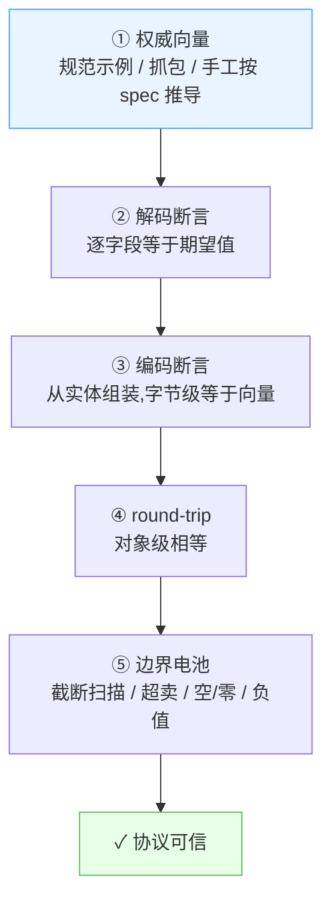

# 如何测试你的协议

> 模板仓库(位于 `redesign/protocol-stack` 分支):`netproto-core/src/test/java/com/netproto/` 下的
> `protocols/real/`(18 个真实协议族,权威字节向量)与 `core/Boundary*Test`(格式边界电池)。
> 这份文档就是它们的方法论。

## 方法总览



**核心信条:测试的公信力来自外部向量,不是「自己编码再自己解码」。**

## 1. 直连引擎(不起 Spring)

```java
ProtocolCodec<MyFrame> codec = new ProtocolCodec<>(MyFrame.class);

byte[] wire = codec.serialize(frame);        // 组装
MyFrame back = codec.deserialize(wire);      // 解析
```

夹具惯例:测试类内静态 `@Data @Protocol` 实体 + AssertJ **字节级**断言
(`containsExactly` 逐字节,不许只比长度)。

## 2. 权威向量从哪来(优先级从高到低)

| 来源 | 例子 | 可信度 |
|---|---|---|
| 规范原文示例 | MQTT 规范 CONNECT 示例、IEC 104 的 `68 04 07 00 00 00` | ★★★ |
| 公开标准校验向量 | CRC-16/MODBUS 的 `"123456789" → 0x4B37`、QUIC varint RFC §16 四向量 | ★★★ |
| 抓包(Wireshark 核对) | 现网帧 | ★★☆ |
| 手工按 spec 推导 | 自算 CS/XOR(推导依据写进注释) | ★★☆ |

手导向量必须把**推导依据**写进注释;「我记得是这几个字节」不算依据。

## 3. 校验和协议:三方自证

测试内放一个**独立参考实现**(按 spec 手写),三方一致才算数:

```java
// ① 参考实现自证:标准向量证明参考实现正确
assertThat(crc16Modbus("123456789".getBytes())).isEqualTo(0x4B37);

// ② 引擎产出的帧,用参考实现交叉验证
byte[] wire = codec.serialize(req);
assertThat(crc16Modbus(wire, 0, wire.length - 2))
        .isEqualTo(((wire[wire.length-1] & 0xFF) << 8) | (wire[wire.length-2] & 0xFF));

// ③ 解码回读的校验和字段值 == 参考实现重算值
assertThat(codec.deserialize(wire).getCrc()).isEqualTo((int) crc16Modbus(wire, 0, 6));
```

反码和族(ICMP/TCP)加一条性质断言:**含校验和的整帧反码折叠和 == 0xFFFF**。

## 4. 边界电池(来自 Boundary*Test 的教训清单)

| 类别 | 用例 | 防什么 |
|---|---|---|
| 截断扫描 | 完整帧 **0..n-1 全前缀截断**,每个截断点必须抛异常 | 部分解析成功返回垃圾 |
| 超卖 | lengthField/countField 宣称大于实际 → 干净失败(报文含需求量/剩余量) | 越界读、静默截断 |
| 空/零 | count=0、空 payload、零长字符串、空 LIST(注意 count 自动回填) | 编码期一致性误报 |
| 负值 | 计数 -1(null 数组语义)round-trip;**< -1 必须报错** | 静默空列表 |
| 条件两态 | presentIf 每个分支都测,「条件不满足」也断言字节缺席 | 假值陷阱 |
| 端序 | 同帧混合 LE/BE;校验和字段 LE 时解码与回写都正确 | 编解码端序不对称 |
| 极值 | 无符号 63bit 上限、有符号负数、BCD 满 16 位 | 溢出/符号扩展 |

```java
// 截断扫描模板
byte[] full = codec.serialize(frame);
for (int cut = 0; cut < full.length; cut++) {
    byte[] truncated = java.util.Arrays.copyOf(full, cut);
    assertThrows(RuntimeException.class, () -> codec.deserialize(truncated),
            "截断到 " + cut + " 字节时必须失败");
}
```

## 5. 常见坑(引擎行为,不是 bug)

- **前向引用禁令**:`lengthField/countField/presentIf` 只能引用更早字段 —— 想引用后面的值,改 order 或用钩子;
- **位索引按声明 size 从 MSB 数**:8bit 字段的 bit2(值 0x04)= `bitmap[6]`;
- **LITTLE 只支持整字节定长整数**(位字段无字节序);FLOAT 支持 LITTLE;
- **非字节对齐的 BYTES/STRING/NESTED 支持**(位级读写,编解码对称);
- **LIST 元素最后一个字段必须自定界**(size/lengthField/LIST),否则注册期拒绝;
- **absent 字段保持 Java 默认值** —— 判断字段是否在线上用 `lastFieldRanges`,不用值;
- **8bit int 字段读 0xFF = 255**(按 Java 类型零扩展),要负数声明 `byte`;
- **`lengthUnit = BITS` 的值必须是 8 的倍数**(BYTES 族按整字节读)。

## 6. 跑法

```bash
mvn test                              # 全量(core 216 / web 16 / demo 23)
mvn -pl netproto-core test -Dtest='ModbusRtuRealTest'   # 单类
```

Windows Git Bash 过滤输出:`mvn test 2>&1 | tr -d '\r' | grep "Tests run" | tail -1`。
